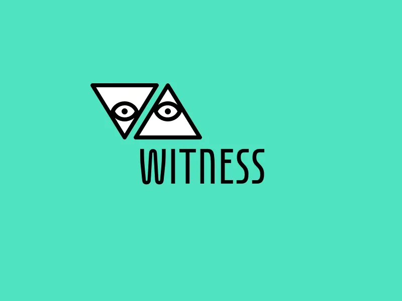

# Witness

Self-hosted, distributed social network written in PHP 5.2 or greater.

### Setup

1. create `data` directory
2. create `mentions.json`, `posts.json`, `witnesses.json` files under `data`
3. set json files with chmod 777
4. create md5 of your password
5. set `$password` variable in `config.php` to md5 value
6. `static/icon.png` must be 192x192 pixels, acts as avatar and site icon
7. use a subdomain for Witness, this way www and non-www is avoided

### Demo

- http://w.lucianmarin.com/
- http://demo.lucianmarin.com/

### Resources

- https://sublevel.net/
- https://dribbble.com/shots/3362402-Witness
- https://cpbotha.net/2016/11/19/lets-replace-twitter-with-something-much-better/
